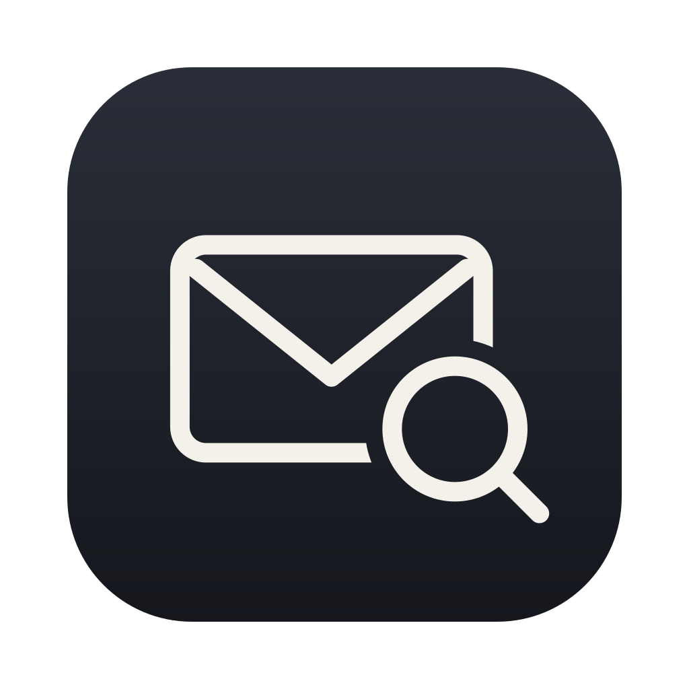

<p align="center">
  
</p>

<h1 align="center">msg-preview</h1>

<p align="center">Quick Look for Outlook <code>.msg</code> files on macOS.<br>Select a message in Finder, press Space, read it.</p>

## What it does

Outlook saves emails as `.msg` files. macOS cannot preview them. This app installs a Quick Look extension that shows the message body as plain text and lists its attachments, so you can read a `.msg` without opening Outlook.

## Requirements

- macOS 14 or later
- Xcode 15 or later to build

## Install

1. Open `msg-preview.xcodeproj` in Xcode and run the `msg-preview` scheme once. Running registers the Quick Look extension with macOS.
2. Move the built `msg-preview.app` to your Applications folder and launch it once from there.
3. Open System Settings › General › Login Items & Extensions › Quick Look and enable **msg-ql-extension**. The app has a button that takes you straight there.

## Use

Select any `.msg` file in Finder and press Space. The preview shows the subject as the title and the message body as text. Attachments are passed to Quick Look so they appear in the preview as well.

If the preview does not update after a rebuild, reset Quick Look:

```
qlmanage -r
```

## Development

The parsing lives in the local Swift package `MsgPreviewCore`, which wraps [MsgReader](https://github.com/hughbe/MsgReader). Run its tests with:

```
cd MsgPreviewCore && swift test
```

Debug builds add a Debug window to the app for importing `.msg` files and inspecting what the parser returns. Release builds do not contain it.

The app icon is `AppIcon.svg`. Regenerate the asset catalog after changing it:

```
swift scripts/render-icon.swift
```

## Credits

- [MsgReader](https://github.com/hughbe/MsgReader) by Hugh Bellamy parses the Outlook message format.
- Test fixtures come from [jotlmsg](https://github.com/ctabin/jotlmsg), Apache License 2.0.

## License

msg-preview is released under the [MIT License](LICENSE).

Most dependencies are MIT licensed. MsgReader and CompressedRtf currently carry no license file, so until their author adds one, build the app from source for your own use rather than redistributing binaries.
